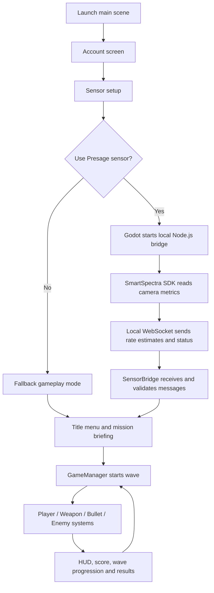
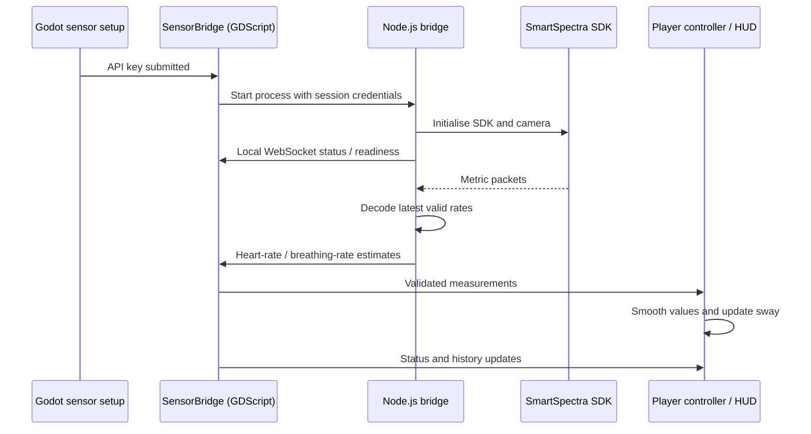

# STEADYSHOT

**A physiology-aware, first-person sniper game built with Godot 4.**

SteadyShot puts you on a desert-canyon overlook. Hold the position, track advancing infantry, account for wind and bullet drop, and stop enemies before they cross the breach line. When a compatible Presage SmartSpectra setup is available, webcam-derived heart-rate and breathing-rate estimates feed into the aiming-stability model. The sensor is optional: the game remains playable without it.

> **Project:** SteadyShot  
> **Engine:** Godot 4.2+  
> **Primary language:** GDScript  
> **Optional sensor runtime:** Node.js + Presage SmartSpectra SDK  
> **Window / viewport:** 1600 × 900 (resizable/scalable through Godot display settings)

---


## Contents

- [Gameplay overview](#gameplay-overview)
- [Features](#features)
- [Getting started](#getting-started)
- [Using the Presage SmartSpectra sensor](#using-the-presage-smartspectra-sensor-optional)
- [Controls](#controls)
- [Game systems](#game-systems)
- [Architecture](#architecture)
- [Project structure](#project-structure)
- [Configuration and saved data](#configuration-and-saved-data)
- [Releases and builds](#releases-and-builds)
- [Troubleshooting](#troubleshooting)
- [Privacy and sensor limitations](#privacy-and-sensor-limitations)
- [Development notes](#development-notes)

---

## Gameplay overview

You defend a sniper position above a desert valley. Enemy units advance in waves along terrain-aware routes. Every enemy that crosses the marked breach line costs one of your lives.

A successful shot is not just about putting the reticle over a target:

- **Range matters:** projectiles take time to reach distant targets.
- **Ballistics matter:** bullets are affected by gravity and wind.
- **Weapon handling matters:** the bolt-action rifle has a six-round magazine, a cycling delay, recoil, and reload time.
- **Conditions matter:** night waves and sandstorms change visibility and the information available through the optic.
- **Physiology can matter:** when the optional sensor is connected and providing fresh, sufficiently confident readings, heart rate and breathing influence aim sway and shot-consistency feedback.

The aim is to make each shot feel deliberate. There is no focus-mode or breath-hold mechanic.

---

## Features

### Tactical sniper gameplay

- First-person aiming from a defended sniper nest.
- Mouse look and limited movement around the position.
- Bolt-action rifle with a six-round magazine.
- Manual reload and automatic reload when the magazine is empty.
- Recoil, weapon movement, chambering, magazine handling, muzzle flash, and ejected brass.
- Multiple rifle-shot sound variants and distinct hit, impact, bolt, and reload audio.
- Simulated projectile travel, gravity drop, and wind drift.
- Rifle zeroing at 150 metres.
- Mil-dot scope reticle for estimating target lead and holdover.

### Enemy waves and mission progression

- Enemies advance through terrain-aware lanes and can walk, sprint, and vary their movement.
- Body and head hit detection, hit reactions, and armoured enemies.
- Headshots reward more points.
- Enemies that pass the red-flag breach line cost a life.
- Wave progression, score, kills, headshots, accuracy, longest shot, first-shot reaction time, and shot-consistency statistics.
- Radar/minimap with a breach-line warning and proximity alerts.
- A saved top-eight scoreboard.

### Dynamic environment

- Desert canyon terrain, rock formations, distant mountains, and a detailed sniper position.
- Wind that affects projectile drift and is represented on the HUD.
- Day/night transitions. Every third wave is a night wave.
- Sandstorms. Every fifth wave brings a sandstorm, including during night conditions.
- Environmental fog, lighting changes, wind-blown sand, and radar interference.
- Scoped night vision on night waves.
- Scoped, high-contrast red/orange enemy thermal highlights during sandstorms.

### Optional physiology integration

- Optional Presage SmartSpectra integration for webcam-derived heart-rate and breathing-rate estimates.
- Live sensor status and validation hints.
- Confidence and freshness checks, smoothing, and gradual recovery when data becomes stale.
- In-game history graphs for received heart-rate and breathing-rate estimates.
- Sensor-driven scope sway and shot-consistency feedback.
- Guest play and sensor-free fallback mode.

### Player experience

- Local sign-up and login, plus guest play.
- Separate local player score records.
- Optional “keep me signed in” behaviour.
- Commander briefing before deployment.
- Pause, restart, audio controls, and game-over screens.
- Master, sound-effects, and ambience volume controls.

---

## Getting started

There are two ways to run SteadyShot: download a packaged build from **GitHub Releases**, or open the Godot project from source.

### Option A — Download a release

1. Open the repository's **Releases** page.
2. Download the latest release asset for your operating system.
3. Extract the archive if it is provided as a ZIP.
4. Launch the SteadyShot executable/application.
5. Sign in, create a local account, or choose guest play.
6. At sensor setup, either connect a SmartSpectra API key or choose **Continue Without Sensor**.
7. From the title menu, start the mission, review the briefing, and deploy.

> Release downloads are separate from the source repository. Check the release notes for the version number, included files, and any version-specific instructions.

### Option B — Run from source with Godot

#### Requirements

- [Godot Engine](https://godotengine.org/) **4.2 or later**.
- The standard Godot editor/engine build. The project does not require a custom engine build.
- A computer capable of running a 3D Godot project.
- **Optional:** Node.js and npm if you want to use the Presage sensor bridge.

#### Steps

1. Clone the repository:

   ```bash
   git clone https://github.com/Yasovardan-Ram/Steady-Shot.git
   cd Steady-Shot
   ```

2. Open Godot.
3. Choose **Import** and select the `project.godot` file in the repository root.
4. Open the project in the editor and allow Godot to import the assets.
5. Press **F5** (Run Project).

The main scene is configured in `project.godot` as `res://scenes/main.tscn`.

On first launch, the game displays the account screen. Create an account or choose guest play, then complete or skip sensor setup. Select **Start Mission**, review the commander briefing, and deploy.

---

## Using the Presage SmartSpectra sensor (optional)

SteadyShot can use the Presage SmartSpectra Node SDK to receive heart-rate and breathing-rate estimates from a camera session. This integration is optional and is not required to launch or play the game.

### What you need

- A valid Presage SmartSpectra API key and access to the relevant SDK service.
- Node.js and npm installed and available on your system `PATH`.
- A working camera.
- Adequate lighting and a camera position that can see your face and upper chest.

### Connect

1. Launch SteadyShot.
2. Sign in or choose guest play.
3. On the sensor setup screen, paste your SmartSpectra API key.
4. Select **Connect Sensor**.
5. Follow the on-screen camera/readiness hints. Keep one person in frame, face the camera, and make sure your face and upper chest are visible.
6. Start a mission once setup finishes.

The first sensor connection checks for the bridge dependencies and automatically runs `npm install` in `presage_bridge/` if they are not present. This first-time setup requires an internet connection. Later launches reuse the installed dependencies.

The bridge uses the dependencies declared in `presage_bridge/package.json`:

- `@smartspectra/node-sdk` `3.5.0`
- `ws` `8.x`

The game starts `presage_bridge/sensor.js` as a local Node.js process. The bridge listens on `127.0.0.1:8765` and communicates with the game over a local WebSocket connection.

### Play without the sensor

Choose **Continue Without Sensor** on the setup screen. The game will use its fallback aiming behaviour and all core gameplay systems remain available.

If the sensor cannot initialise, the game is designed to continue in fallback mode rather than requiring the sensor to play.

---

## Controls

| Input | Action |
|---|---|
| `W` `A` `S` `D` | Move within the sniper position's movement limits |
| Mouse | Aim / look |
| Left mouse button | Fire |
| Right mouse button | Toggle scope |
| Mouse wheel | Change scope magnification: 4× / 8× / 12× |
| `R` | Reload |
| `N` | Toggle the scoped night-vision / thermal optic during night or sandstorm waves |
| `Esc` | Pause or resume; return from the briefing to the title menu |
| `Enter` / `Space` | Continue from the title menu or deploy from the briefing when available |

**Weapon notes**

- The rifle holds six rounds.
- The bolt must cycle between shots.
- Reloading takes the rifle out of the scope.
- An empty magazine triggers an automatic reload.
- Shots are simulated projectiles, not instant hitscan: allow for travel time, drop, and wind.

---

## Game systems

### Waves, lives, and scoring

Enemies move through the valley toward the breach line. You begin with five lives. Each enemy that gets through the breach line costs one life. Clear the wave to progress.

The mission summary tracks performance such as score, kills, headshots, accuracy, longest shot, first-shot reaction time, and shot consistency. The local scoreboard stores the top eight results for the player profile.

### Ballistics and wind

The rifle fires simulated projectiles. Each projectile is advanced over time and checked along its path for collisions, so targets and world geometry can be hit during flight.

The projectile model accounts for:

- Initial muzzle velocity.
- Gravity.
- Wind acceleration.
- Rifle zero range.

The wind gauge reflects the wind used by the projectile simulation. Wind remains a gameplay factor, but physiological input is the primary source of sensor-driven aim influence.

### Night waves

Every third wave (3, 6, 9, …) is a night wave. The environment transitions toward a darker sky and moonlit lighting, with night ambience. Press `N` while playing to toggle the scoped night-vision optic.

Night vision affects the view through the scope; it does not turn the entire screen into a night-vision display.

### Sandstorm waves

Every fifth wave (5, 10, 15, …) is a sandstorm wave. Sandstorms add blown sand, haze, reduced visibility, stronger environmental effects, and radar interference. Press `N` during a sandstorm to enable the scoped thermal view, which highlights enemy heat signatures in red/orange.

If a wave is both a night wave and a sandstorm wave, the scoped optic uses the thermal treatment for that storm condition.

### Sensor-driven aim and shot consistency

When valid sensor measurements are available, the player controller uses heart-rate and breathing-rate estimates to influence scope sway. Incoming readings are smoothed and checked for confidence and freshness. Stale or missing measurements fade out rather than being treated as current data.

Shot-consistency feedback is calculated at the time the shot is fired. It considers available sensor freshness, physiological load, breathing phase, and player movement. Shots without fresh sensor data are marked as unrated rather than being presented as measured sensor results.

The sensor estimates are intended for gameplay only. They are not medical measurements or a diagnostic tool.

---

## Architecture

SteadyShot is organised as a Godot scene-based application. The main scene composes the world, player, enemies, effects, HUD, sensor bridge, and game manager. Gameplay systems are separated into scripts with focused responsibilities.

### Runtime flow



### Main responsibilities

| Component | Responsibility |
|---|---|
| `scenes/main.tscn` | Composes the playable world and top-level systems |
| `scripts/game_manager.gd` | Game states, waves, spawning, scoring, lives, menus, settings, and saved results |
| `scripts/player_controller.gd` | Player movement, mouse look, scope/zoom, recoil, sway, and sensor-driven aim influence |
| `scripts/weapon.gd` | Magazine, firing, bolt cycle, reload, weapon animation, and projectile spawning |
| `scripts/bullet.gd` | Projectile movement, gravity, wind drift, ray-based collision checks, and hit registration |
| `scripts/enemy.gd` | Enemy movement, lane following, hit reactions, and enemy state |
| `scripts/lane_data.gd` | Precomputed enemy movement lanes |
| `scripts/terrain_sampler.gd` | Terrain-height sampling used by movement and lane placement |
| `scripts/day_night.gd` | Day/night and sandstorm environment transitions |
| `scripts/night_vision.gd` | Scoped night-vision and thermal optic effects |
| `scripts/sandstorm.gd` | Sand particles, screen haze, and wind-aligned storm presentation |
| `scripts/hud.gd` | HUD composition and display updates |
| `scripts/scope_reticle.gd` | Scope reticle and mil-dot display |
| `scripts/radar.gd` | Enemy radar and breach-line indicators |
| `scripts/menu_panel.gd` | Title, briefing, pause, and game-over UI |
| `scripts/auth_panel.gd` / `scripts/accounts.gd` | Local account interface and account data |
| `scripts/sensor_setup.gd` | Session-only API-key entry and sensor setup UI |
| `scripts/sensor_bridge.gd` | Starts/stops the local Node.js process and handles WebSocket messages |
| `presage_bridge/sensor.js` | SmartSpectra SDK lifecycle, camera status, metric decoding, and local metric forwarding |
| `scripts/sensor_history.gd` | Heart-rate and breathing-rate history graphs |
| `scripts/ambience.gd` / `scripts/audio_buses.gd` | Environmental audio and audio-bus/volume management |
| `scripts/scenery.gd` / `scripts/wind_gauge.gd` | Runtime scenery and wind display |

### Presage data path



The WebSocket server binds to loopback (`127.0.0.1`) and the game authenticates its local connection with a random per-session token. The API key is supplied to the bridge through a temporary process environment variable and is not sent over the WebSocket. SDK telemetry is disabled in the bridge configuration.

---

## Project structure

```text
Steady-Shot/
├── project.godot
├── README.md
├── .gitignore
│
├── scenes/
│   ├── main.tscn
│   ├── player.tscn
│   ├── weapon.tscn
│   ├── bullet.tscn
│   ├── enemy.tscn
│   ├── hud.tscn
│   └── environment/
│       ├── desert_canyon.tscn
│       ├── components/
│       ├── meshes/
│       └── materials/
│
├── scripts/
│   ├── game_manager.gd
│   ├── player_controller.gd
│   ├── weapon.gd
│   ├── bullet.gd
│   ├── enemy.gd
│   ├── lane_data.gd
│   ├── terrain_sampler.gd
│   ├── day_night.gd
│   ├── night_vision.gd
│   ├── sandstorm.gd
│   ├── hud.gd
│   ├── scope_reticle.gd
│   ├── radar.gd
│   ├── sensor_bridge.gd
│   ├── sensor_setup.gd
│   ├── sensor_history.gd
│   ├── accounts.gd
│   ├── auth_panel.gd
│   ├── menu_panel.gd
│   ├── ambience.gd
│   ├── scenery.gd
│   ├── audio_buses.gd
│   └── ...
│
├── presage_bridge/
│   ├── sensor.js
│   └── package.json
│
├── audio/
│   └── music, ambience, weapon, UI, and environment audio
│
└── CHANGELOG_*.md
```

Godot's `.godot/` directory is generated editor/import data. It is intentionally excluded from version control and is recreated by the editor.

---

## Configuration and saved data

Player data is stored locally using Godot's `user://` directory; it is not a cloud account system.

| Data | Location |
|---|---|
| Account records | `user://accounts.cfg` |
| Remembered login | Managed by the local account system |
| Game settings and legacy scoreboard data | `user://steadyshot.cfg` |
| Imported/editor cache | Project-local `.godot/` directory (generated; not committed) |

Accounts and scoreboards are local to the computer on which the game is played. They are not synchronised between devices or uploaded to GitHub.

---

## Releases and builds

Packaged downloads should be published through the repository's **GitHub Releases** section rather than committed to the source tree.

Suggested release contents:

- A Windows ZIP containing the exported game executable and its required Godot `.pck`/support files, if applicable to the export configuration.
- A short release note describing the version, changes, and known issues.
- Optional checksums for downloaded archives.

**Do not commit exported `.exe` files or other large build artifacts to the Git repository.** GitHub blocks individual Git files larger than 100 MB. Keep release binaries attached to GitHub Releases instead.

### Exporting from Godot

1. Open the project in Godot.
2. Open **Project → Export**.
3. Add/configure the export preset for the target platform.
4. Install the export templates if Godot requests them.
5. Export the project to a separate build/output directory.
6. Test the exported build on a clean machine or user account before publishing it.
7. Zip the complete exported output and attach it to a GitHub Release.

The exact exported files depend on the platform and export preset. The optional Presage integration also requires Node.js/npm on the target computer unless the bridge runtime and dependencies are packaged separately.

---

## Troubleshooting

### Godot asks to import the project

Open the repository's `project.godot` file through Godot's **Import** workflow and allow the initial asset import to finish. The `.godot/` cache is generated locally.

### The game starts without sensor readings

Choose sensor-free play to confirm the core game works. For sensor mode, check that:

- Node.js and npm are installed and available in `PATH`.
- The API key is valid and has access to SmartSpectra.
- The camera is available and not exclusively occupied by another application.
- Your face and upper chest are visible, centred, and adequately lit.
- The first-time dependency installation has internet access.

Read the sensor status text in-game for camera readiness and validation hints. If the bridge fails to start or initialise, the game should remain playable in fallback mode.

### The sensor bridge cannot install dependencies

Check your internet connection and npm installation. You can also install the bridge dependencies manually:

```bash
cd presage_bridge
npm install
```

Then restart the game and try connecting again.

### Git rejects a large executable

Keep generated executables out of Git history and use GitHub Releases for downloads. Adding a file to `.gitignore` prevents future tracking, but does not remove a file that is already present in earlier commits.

---

## Privacy and sensor limitations

- The Presage sensor integration is optional.
- The API key is entered at runtime and is not intended to be stored in the project or player settings.
- The local bridge binds to `127.0.0.1`; it is designed for communication between the game and the bridge on the same computer.
- The bridge disables SmartSpectra SDK telemetry.
- The game receives rate estimates and status information, not raw ECG or respiratory waveforms.
- Heart-rate and breathing-rate estimates are used for game mechanics and are not medical measurements, diagnoses, or health advice.
- Local account and scoreboard data remain on the player's computer.

Do not publish API keys, `.env` files, export credentials, or other secrets in source control or release archives.

---

## Development notes

- Main scene: `res://scenes/main.tscn`
- Project configuration: `project.godot`
- Engine compatibility: Godot 4.2+
- Optional bridge: `presage_bridge/`
- Version history: `CHANGELOG_*.md` and `POLISH_CHANGELOG.txt`

When changing gameplay systems, keep responsibilities separated: the game manager coordinates state and progression, while player, weapon, projectile, enemy, HUD, environment, and sensor scripts own their respective behaviour.

When changing the Presage integration, preserve the sensor-free fallback path. The game must remain playable when the SDK, camera, API key, or network dependency setup is unavailable.

---

## Acknowledgements

- **Godot Engine** — game engine and runtime.
- **Presage SmartSpectra** — optional camera-based physiological metric SDK.
- Audio and other third-party assets remain subject to their respective licences and attribution requirements.

---

*SteadyShot — Hold the line. Make every shot count.*
